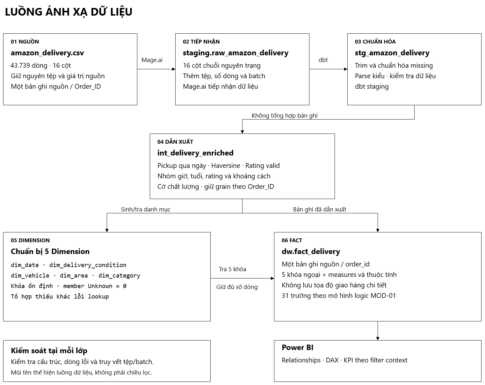
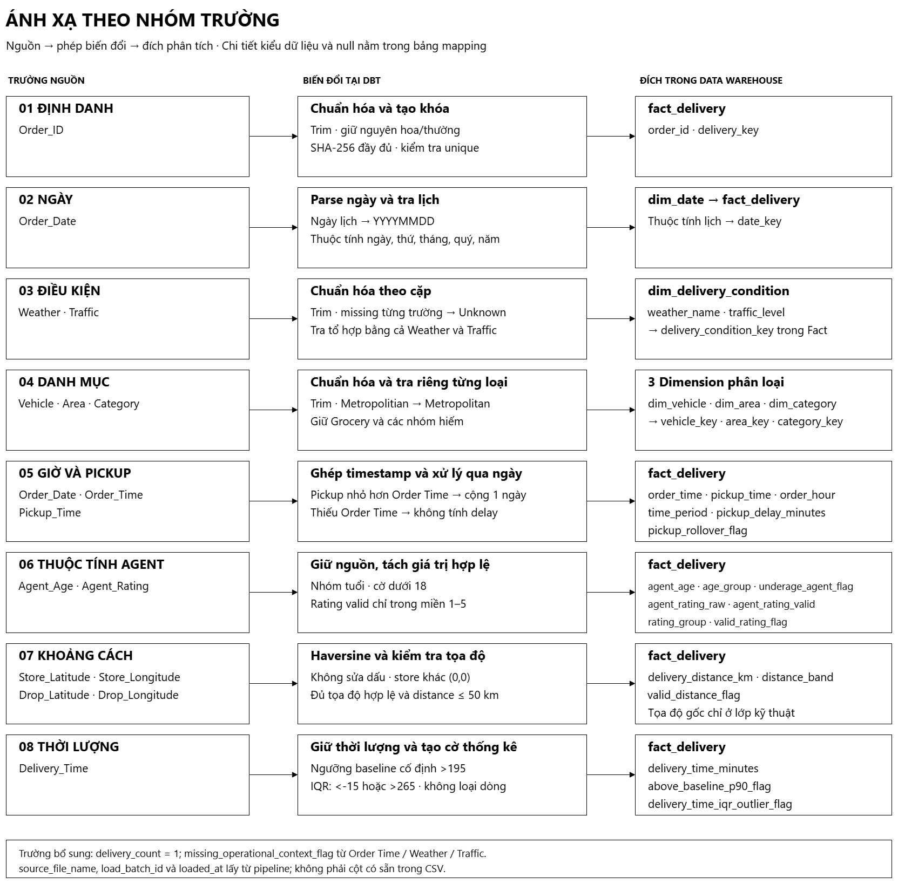

# Ánh xạ dữ liệu nguồn vào Data Warehouse

| Thông tin | Nội dung |
|---|---|
| Công việc | MAP-01 — Source-to-Target Mapping |
| Ngày lập | 17/10/2026 |
| Nguồn | Amazon Delivery Dataset, tệp `01_data/raw/amazon_delivery.csv` |
| Cơ sở thiết kế | Business Baseline v2 và mô hình logic MOD-01 đã duyệt |
| Trạng thái | Bản đề xuất để rà soát; chưa được phê duyệt ở mức vật lý |

## 1. Phạm vi và cơ sở thiết kế

Tài liệu ánh xạ 16 cột CSV vào năm Dimension và 31 trường của `dw.fact_delivery`, gồm kiểu dữ liệu, phép biến đổi và cách xử lý thiếu dữ liệu. Grain giữ theo MOD-01: **một dòng Fact là một bản ghi giao hàng nguồn có `Order_ID` hợp lệ, duy nhất trong snapshot**. Nguồn không có trạng thái giao hàng nên không thể xem mỗi dòng là một lần giao thành công.

Tên bảng, trường logic, khóa và quy tắc nghiệp vụ tuân theo MOD-01 và Business Baseline. Tên lớp trung gian, kiểu dữ liệu, thuật toán khóa, quy ước lịch và ranh giới nhóm dưới đây là **đề xuất MAP-01**. MOD-02 chưa có đặc tả schema vật lý được duyệt; các đề xuất này cần được rà soát trước triển khai.

CSV hiện tại có 43.739 dòng, 16 cột và 43.739 `Order_ID` phân biệt, trải từ 11/02/2022 đến 06/04/2022 với 44 ngày có dữ liệu. Dataset được sử dụng theo tên người đăng Kaggle cung cấp, không phải bằng chứng về dữ liệu vận hành chính thức của Amazon. Đơn vị phút của `Delivery_Time` là giả định đã được nhóm chấp nhận; metadata nguồn chưa xác nhận đơn vị này.

## 2. Luồng ánh xạ



*Hình 1. Luồng xử lý đề xuất; mũi tên biểu diễn phụ thuộc dữ liệu.*

| Lớp | Tên đề xuất | Nội dung |
|---|---|---|
| Nguồn | `amazon_delivery.csv` | Giữ nguyên tệp, tên cột và giá trị nguồn |
| Tiếp nhận | `staging.raw_amazon_delivery` | Mage.ai nạp đủ 16 cột dưới dạng chuỗi, kèm thông tin truy vết tệp, dòng và batch |
| Chuẩn hóa | `stg_amazon_delivery` | dbt đổi tên theo `snake_case`, trim, chuẩn hóa giá trị thiếu và chuyển kiểu |
| Dẫn xuất | `int_delivery_enriched` | Tính pickup delay, khoảng cách, nhóm phân tích và cờ chất lượng; giữ grain nguồn |
| Kho dữ liệu | Năm bảng `dw.dim_*`, `dw.fact_delivery` | Chuẩn bị Dimension, tra khóa rồi nạp Fact |
| Phân tích | Power BI | Quan hệ Dimension 1 → Fact nhiều, lọc một chiều; tính KPI theo bộ lọc hiện tại |



*Hình 2. Ánh xạ theo nhóm trường; một trường nguồn có thể hỗ trợ nhiều trường đích.*

## 3. Quy tắc chung

- Raw giữ nguyên giá trị, kể cả khoảng trắng và chuỗi biểu diễn giá trị thiếu. Việc chuẩn hóa chỉ thực hiện ở lớp biến đổi.
- Trim đầu/cuối chuỗi; chuyển chuỗi rỗng, `NaN` và các giá trị tương đương null thành SQL `NULL`. Giữ nguyên hoa/thường của `Order_ID` và khoảng trắng bên trong mã.
- Chuyển kiểu theo định dạng ở bảng ánh xạ. Lỗi chuyển kiểu, tràn số hoặc chuỗi vượt độ dài đề xuất phải được ghi nhận riêng, không coi là dữ liệu thiếu hoặc âm thầm cắt/làm tròn.
- Giữ bản ghi thiếu Order Time, Weather, Traffic hoặc Rating. Rating ngoài miền, tuổi dưới 18, khoảng cách không hợp lệ và IQR outlier chỉ ảnh hưởng thuộc tính hoặc phép tính tương ứng.
- `order_id` phải duy nhất, không null; `delivery_key` ổn định theo `order_id`. Không tra được Dimension thì dùng key `0` và ghi audit, tránh làm mất dòng Fact.
- Chi tiết xử lý ID không hợp lệ, trùng lặp, rejected và chạy lại thuộc LOAD-01.

## 4. Ánh xạ 16 cột nguồn

Các trường sau chuẩn hóa là đầu ra của `stg_amazon_delivery`. Bốn tọa độ chỉ giữ ở lớp kỹ thuật để tính khoảng cách và đối soát.

| Mã | Cột CSV / cột raw | Trường sau chuẩn hóa, kiểu đề xuất | Đích và vai trò | Biến đổi và kiểm tra |
|---|---|---|---|---|
| S01 | `Order_ID` | `order_id varchar(32)` | `fact_delivery.order_id`; đầu vào `delivery_key` | Trim, giữ nguyên hoa/thường. Không null và duy nhất trong Fact; lỗi ID được ghi nhận để xử lý ở LOAD-01 |
| S02 | `Agent_Age` | `agent_age smallint` | `fact_delivery.agent_age`, `age_group`, `underage_agent_flag` | Chuyển sang số nguyên, không làm tròn số thập phân. Giữ tuổi 15 và 50; `<18` gắn cờ, không xóa dòng |
| S03 | `Agent_Rating` | `agent_rating_raw decimal(4,2)` | `fact_delivery.agent_rating_raw`, `agent_rating_valid`, `rating_group`, `valid_rating_flag` | 54 giá trị thiếu thành null. Giữ rating 6 ở trường raw đã chuyển kiểu; chỉ miền 1–5 được đưa vào trường valid |
| S04 | `Store_Latitude` | `store_latitude decimal(12,8)` | Đầu vào `delivery_distance_km`, `valid_distance_flag`, `distance_band` | Chuyển kiểu latitude; giữ dấu và `(0,0)`. Kiểm tra miền `[-90,90]`; không đưa tọa độ vào DW công khai |
| S05 | `Store_Longitude` | `store_longitude decimal(12,8)` | Cùng S04 | Chuyển kiểu longitude, kiểm tra miền `[-180,180]`; không đổi dấu |
| S06 | `Drop_Latitude` | `drop_latitude decimal(12,8)` | Cùng S04 | Chuyển kiểu latitude; giữ nguyên tọa độ tại lớp kỹ thuật, không công khai chi tiết |
| S07 | `Drop_Longitude` | `drop_longitude decimal(12,8)` | Cùng S04 | Chuyển kiểu longitude; không tự thay vị trí hoặc sửa dấu |
| S08 | `Order_Date` | `order_date date` | `dim_date.full_date` và thuộc tính lịch; `fact_delivery.date_key`; ghép timestamp pickup | Đọc đúng định dạng `YYYY-MM-DD`. Ngày thiếu/không chuyển kiểu được dùng date key 0 và ghi audit theo MOD-01 |
| S09 | `Order_Time` | `order_time time(0)` | `fact_delivery.order_time`, `order_hour`, `time_period`; đầu vào pickup delay và cờ thiếu context | Đọc định dạng `HH:MM:SS`; 91 giá trị thiếu thành null, không thay bằng `00:00:00` |
| S10 | `Pickup_Time` | `pickup_time time(0)` | `fact_delivery.pickup_time`, `pickup_delay_minutes`, `pickup_rollover_flag` | Đọc định dạng `HH:MM:SS`; so với Order Time để xác định cộng ngày; thiếu đầu vào thì không tính delay |
| S11 | `Weather` | `weather_name nvarchar(32)` | `dim_delivery_condition.weather_name`; tra `delivery_condition_key` trong Fact | Trim; giá trị thiếu thành null tại staging, thành `Unknown` khi tra Dimension; không loại 91 dòng thiếu |
| S12 | `Traffic` | `traffic_level nvarchar(32)` | `dim_delivery_condition.traffic_level`; tra cùng khóa với Weather | Trim toàn bộ giá trị; xử lý thiếu dữ liệu như S11; không nối riêng Weather và Traffic bằng hai FK |
| S13 | `Vehicle` | `vehicle_type nvarchar(32)` | `dim_vehicle.vehicle_type`; `fact_delivery.vehicle_key` | Trim; giữ `bicycle` dù chỉ có 15 dòng; thiếu dùng Unknown, không tự đổi tên phân loại |
| S14 | `Area` | `area_name_raw nvarchar(64)`, `area_name nvarchar(64)` | `dim_area.area_name`; `fact_delivery.area_key` | Bản raw vẫn giữ nguyên; bản chuẩn hóa đổi đúng `Metropolitian` thành `Metropolitan`, các giá trị khác chỉ trim |
| S15 | `Delivery_Time` | `delivery_time_minutes decimal(10,2)` | Fact: thời lượng, cờ vượt 195 và cờ IQR | Giữ mọi giá trị 10–270 trong snapshot, kể cả 79 outlier; không suy ra trạng thái giao trễ |
| S16 | `Category` | `category_name nvarchar(64)` | `dim_category.category_name`; `fact_delivery.category_key` | Trim; giữ đủ 16 nhóm và giữ nguyên Grocery; không tự sửa thời lượng của Grocery |

## 5. Ánh xạ Dimension và khóa ngoại

### 5.1. `dw.dim_date`

Đề xuất sinh lịch đủ năm 2022, kèm member key `0`. Các thuộc tính lịch sau đây dùng ngày dương lịch; `week_of_year` đề xuất theo ISO 8601.

| Cột đích | Kiểu đề xuất | Nguồn / quy tắc | Null |
|---|---|---|---|
| `date_key` | `int` | `YYYYMMDD` của `full_date`; Unknown bằng 0 | Không |
| `full_date` | `date` | Lịch 01/01–31/12/2022; Unknown bằng null | Chỉ key 0 |
| `day_of_month` | `tinyint` | Ngày trong tháng, 1–31 | Chỉ key 0 |
| `day_name` | `nvarchar(16)` | Thứ Hai đến Chủ Nhật theo số thứ; Unknown là `Unknown` | Không |
| `day_of_week_number` | `tinyint` | Thứ Hai = 1, Chủ Nhật = 7; Unknown = null | Chỉ key 0 |
| `week_of_year` | `tinyint` | Số tuần ISO 8601; không dùng tuần mặc định theo session | Chỉ key 0 |
| `month_number` | `tinyint` | 1–12 | Chỉ key 0 |
| `month_name` | `nvarchar(16)` | `Tháng 1` đến `Tháng 12`; Unknown là `Unknown` | Không |
| `quarter_number` | `tinyint` | 1–4 | Chỉ key 0 |
| `year` | `smallint` | Năm dương lịch của `full_date` | Chỉ key 0 |

Fact tra khóa bằng `order_date = full_date`; ngày thiếu hoặc không chuyển kiểu được dùng key `0` và ghi audit theo MOD-01. Active Day đếm ngày có Fact trong cùng bộ lọc, không đếm toàn bộ lịch và không tính key `0`.

### 5.2. Các Dimension phân loại

| Bảng | Cột đích, kiểu đề xuất | Đầu vào và cách ánh xạ | Unknown / kiểm tra |
|---|---|---|---|
| `dw.dim_delivery_condition` | `delivery_condition_key int`; `weather_name nvarchar(32)`; `traffic_level nvarchar(32)` | Một tổ hợp Weather–Traffic đã chuẩn hóa; tra bằng **cả hai** thuộc tính | Mỗi thuộc tính thiếu thành `Unknown`; key 0 dành cho lỗi tra khóa |
| `dw.dim_vehicle` | `vehicle_key int`; `vehicle_type nvarchar(32)` | Tra `vehicle_type` sau trim | Key 0, nhãn `Unknown`; key và natural key không trùng trong tập member nghiệp vụ |
| `dw.dim_area` | `area_key int`; `area_name nvarchar(64)` | Tra `area_name` sau sửa đúng lỗi chính tả đã duyệt | Key 0, nhãn `Unknown`; không dùng tọa độ làm khóa Area |
| `dw.dim_category` | `category_key int`; `category_name nvarchar(64)` | Tra `category_name` sau trim | Key 0, nhãn `Unknown`; Grocery là member bình thường |

Các cột trên đề xuất không null. Giá trị Area gốc giữ tại raw/staging để đối soát. Các Dimension phân loại dùng SCD Type 1; `dim_date` là lịch tĩnh theo MOD-01.

Mỗi Dimension dùng khóa số nguyên, key `0` dành cho Unknown Member hoặc lỗi tra khóa theo MOD-01. Với `dim_delivery_condition`, chuẩn hóa từng thuộc tính thiếu thành `Unknown` rồi tra bằng cả cặp Weather–Traffic; tổ hợp có giá trị thiếu vẫn là một tổ hợp dữ liệu, khác lỗi tra khóa. Giữ natural key đã chuẩn hóa để đối soát.

## 6. Ánh xạ `dw.fact_delivery`

Hai bảng dưới bao phủ đủ 31 trường logic của MOD-01. “Có” ở cột Null nghĩa là cho phép SQL `NULL`; các trường nhóm dùng nhãn `Unknown` khi thiếu đầu vào. Mọi khóa ngoại phải có member tương ứng trong Dimension, kể cả key `0`.

### 6.1. Khóa và thuộc tính phân tích

| Cột đích | Kiểu đề xuất | Null | Nguồn / quy tắc |
|---|---|---|---|
| `delivery_key` | `char(64)` | Không | SHA-256 đầy đủ của `order_id` đã trim, dạng hex; đề xuất tại mục 7.1 |
| `order_id` | `varchar(32)` | Không | S01; giữ mã nguồn đã trim, duy nhất và không null |
| `date_key` | `int` | Không | Tra `dim_date` bằng `order_date`; thất bại dùng 0 và audit |
| `delivery_condition_key` | `int` | Không | Tra cặp Weather–Traffic theo mục 5.2 |
| `vehicle_key` | `int` | Không | Tra Vehicle đã chuẩn hóa |
| `area_key` | `int` | Không | Tra Area đã chuẩn hóa |
| `category_key` | `int` | Không | Tra Category đã chuẩn hóa |
| `order_time` | `time(0)` | Có | S09; giữ null khi thiếu |
| `pickup_time` | `time(0)` | Có | S10; giờ pickup không chứa ngày, ngày dùng tạm khi tính delay |
| `order_hour` | `tinyint` | Có | Giờ của `order_time`, miền 0–23; null nếu thiếu |
| `time_period` | `nvarchar(16)` | Không | Nhóm giờ theo mục 7.5; thiếu giờ = `Unknown` |
| `agent_age` | `smallint` | Có | S02; null khi thiếu; ghi nhận riêng lỗi chuyển kiểu |
| `age_group` | `nvarchar(16)` | Không | Nhóm tuổi theo mục 7.5 |
| `underage_agent_flag` | `bit` | Không | 1 nếu tuổi đã chuyển kiểu `<18`, ngược lại 0; null age không được hiểu là tuổi hợp lệ |
| `agent_rating_raw` | `decimal(4,2)` | Có | S03 sau chuyển kiểu; gồm rating 6, khác với chuỗi nguyên trạng ở raw |
| `agent_rating_valid` | `decimal(4,2)` | Có | Bằng rating raw nếu 1–5; còn lại null |
| `rating_group` | `nvarchar(16)` | Không | Dựa vào `agent_rating_raw`: thiếu = `Unknown`, ngoài [1,5] = `Invalid`; giá trị hợp lệ phân nhóm theo mục 7.5 |
| `valid_rating_flag` | `bit` | Không | 1 nếu rating raw thuộc [1,5], ngược lại 0 |

### 6.2. Đại lượng đo, cờ chất lượng và truy vết

| Cột đích | Kiểu đề xuất | Null | Nguồn / quy tắc |
|---|---|---|---|
| `delivery_time_minutes` | `decimal(10,2)` | Có | S15; null khi thiếu, snapshot hiện tại không có null |
| `above_baseline_p90_flag` | `bit` | Có | 1 nếu thời lượng `>195`, 0 nếu `<=195`, null nếu không có thời lượng hợp lệ |
| `delivery_time_iqr_outlier_flag` | `bit` | Có | 1 nếu thời lượng `<-15` hoặc `>265`, 0 nếu trong khoảng, null nếu thiếu; chỉ là cờ thống kê |
| `pickup_delay_minutes` | `decimal(10,2)` | Có | Tính từ ngày/giờ theo mục 7.2; không tính khi thiếu đầu vào |
| `pickup_rollover_flag` | `bit` | Có | 1 nếu hai giờ hợp lệ và pickup nhỏ hơn order, 0 nếu không nhỏ hơn, null nếu không so sánh được |
| `delivery_distance_km` | `float(53)` | Có | Haversine khi đạt quy tắc khoảng cách hợp lệ; còn lại null |
| `valid_distance_flag` | `bit` | Không | 1 khi đủ tọa độ hợp lệ, store khác `(0,0)` và khoảng cách không quá 50 km; còn lại 0 |
| `distance_band` | `nvarchar(16)` | Không | Nhóm từ khoảng cách hợp lệ; còn lại `Unknown` |
| `delivery_count` | `tinyint` | Không | Hằng số 1 cho mỗi dòng Fact |
| `missing_operational_context_flag` | `bit` | Không | 1 nếu thiếu ít nhất một trong Order Time, Weather, Traffic sau chuẩn hóa; ngược lại 0 |
| `source_file_name` | `nvarchar(260)` | Không | Tên tệp nguồn, do pipeline cung cấp |
| `load_batch_id` | `varchar(64)` | Không | Mã batch được truyền từ pipeline; đối chiếu với audit, không dùng làm grain |
| `loaded_at` | `datetime2(3)` | Không | Thời điểm dòng được nạp vào DW |

## 7. Các phép biến đổi

### 7.1. Khóa bản ghi

Theo MOD-01, `delivery_key` được sinh xác định từ `order_id`, còn `order_id` giữ trực tiếp để đối soát và kiểm tra tính duy nhất. MAP-01 đề xuất dùng SHA-256 đầy đủ, biểu diễn bằng 64 ký tự hex (`char(64)`); không rút gọn hash. Cùng một `order_id` phải cho cùng khóa giữa các lần nạp; cả hai trường cần được kiểm tra tính duy nhất.

### 7.2. Pickup delay

Ghép `order_date` với `order_time` và `pickup_time` thành hai timestamp. Nếu Pickup Time nhỏ hơn Order Time, cộng một ngày cho pickup theo quy tắc đã duyệt. Chênh lệch timestamp tính theo giây rồi chia 60 cho `pickup_delay_minutes`.

Ví dụ: order 23:55, pickup 00:10 cho delay 15 phút và `pickup_rollover_flag=1`. Thiếu đầu vào thì delay null; thiếu Order Time thì `order_hour` và rollover cũng null, không thay giờ thiếu bằng nửa đêm. Snapshot có 828 dòng rollover và 91 dòng delay null.

### 7.3. Khoảng cách Haversine

Đổi tọa độ sang radian, ký hiệu store là `(φ1, λ1)`, drop là `(φ2, λ2)`:

```text
a = sin²((φ2 - φ1)/2) + cos(φ1) × cos(φ2) × sin²((λ2 - λ1)/2)
d = 2 × 6371 × asin(sqrt(clamp(a, 0, 1)))
```

`d` tính bằng km; chặn `a` về [0,1] để tránh sai số số học. Đây là khoảng cách địa lý, không phải chiều dài tuyến đường.

Chỉ đặt `valid_distance_flag=1` khi đủ bốn tọa độ dạng số, latitude thuộc [-90,90], longitude thuộc [-180,180], store khác `(0,0)` và `d<=50`. Nếu không đạt, `delivery_distance_km=NULL`, `distance_band=Unknown`; giữ tọa độ gốc tại raw/staging. Không sửa dấu hoặc loại tọa độ chỉ vì mang dấu âm. Snapshot có 40.046 khoảng cách hợp lệ; 3.505 dòng store `(0,0)` và 188 dòng còn lại có khoảng cách trên 50 km.

### 7.4. Thời lượng và cờ thống kê

Giữ toàn bộ `Delivery_Time` nguồn, kể cả 79 IQR outlier. `above_baseline_p90_flag=1` khi thời lượng `>195`; ngưỡng này cố định theo baseline đã duyệt. KPI P90 Delivery Time vẫn tính lại theo bộ lọc.

Baseline có Q1=90, Q3=160, IQR=70 và hai hàng rào -15, 265. Đề xuất dùng hai hàng rào này cho `delivery_time_iqr_outlier_flag` để đối soát snapshot; đây là cờ chẩn đoán, không phải điều kiện loại dòng.

### 7.5. Ranh giới nhóm phân tích

Các ranh giới sau là đề xuất MAP-01 theo phần được MOD-01 giao, không phải phân loại từ Kaggle. Phân nhóm bằng giá trị chưa làm tròn hiển thị; mỗi phân tích theo nhóm cần kèm số bản ghi.

| Trường | Ranh giới và nhãn đề xuất | Thiếu / ngoài miền |
|---|---|---|
| `time_period` | `[00:00,06:00)` = Night; `[06:00,12:00)` = Morning; `[12:00,18:00)` = Afternoon; `[18:00,24:00)` = Evening | Thiếu giờ = Unknown |
| `age_group` | `<18` = Under 18; `[18,25)` = 18-24; `[25,35)` = 25-34; `[35,45)` = 35-44; `>=45` = 45+ | Thiếu = Unknown; ghi nhận riêng lỗi chuyển kiểu |
| `rating_group` | `[1,3)`; `[3,4)`; `[4,4.5)`; `[4.5,5]` | Thiếu = Unknown; giá trị số ngoài [1,5] = Invalid |
| `distance_band` | `[0,5)` km; `[5,10)` km; `[10,15)` km; `[15,20)` km; `[20,50]` km | Không đạt quy tắc khoảng cách hợp lệ = Unknown |

## 8. Truy vết đến KPI

KPI tổng hợp được tính tại Power BI theo bộ lọc hiện tại; Fact không lưu sẵn average, percentile hoặc tỷ lệ.

| KPI | Trường đầu vào | Điều kiện quan trọng |
|---|---|---|
| KPI-01 Total Deliveries | `order_id`, `delivery_count` | Đếm ID phân biệt; bằng tổng `delivery_count` khi đảm bảo grain và tính duy nhất |
| KPI-02 Average Delivery Time | `delivery_time_minutes` | Bỏ null, giữ IQR outlier |
| KPI-03 Median Delivery Time | Cùng trường trên | Tính lại trên tập dòng hiện tại |
| KPI-04 P90 Delivery Time | Cùng trường trên | Percentile liên tục, tính trên tập dòng hiện tại |
| KPI-05 P95 Delivery Time | Cùng trường trên | Cùng nguyên tắc với P90 |
| KPI-06 Average Pickup Delay | `pickup_delay_minutes` | Chỉ mẫu tính được delay; không đổi null thành 0 |
| KPI-07 Average Valid Delivery Distance | `delivery_distance_km`, `valid_distance_flag` | Chỉ dùng khoảng cách hợp lệ |
| KPI-08 Average Valid Agent Rating | `agent_rating_valid`, `valid_rating_flag` | Không dùng `agent_rating_raw` để tính trung bình trực tiếp |
| KPI-09 Average Deliveries per Active Day | `order_id`, `date_key` | Mẫu số là số ngày phân biệt có Fact trong cùng bộ lọc; loại date key 0 |
| KPI-10 Share Above Baseline P90 | `delivery_time_minutes`, `above_baseline_p90_flag` | Tử số `>195`; mẫu số chỉ các dòng có thời lượng hợp lệ, không phải toàn bộ Fact nếu có null |

## 9. Kiểm tra và đối soát

Các số dưới đây tính lại trên CSV để làm mốc kiểm tra mapping, chưa phải kết quả chạy pipeline hoặc kho dữ liệu.

| Hạng mục | Giá trị đối soát |
|---|---:|
| Tổng dòng / ID phân biệt | 43.739 / 43.739 |
| Ngày có dữ liệu | 44 |
| Delivery Time: mean / median / P90 / P95 | 124,905645 / 125 / 195 / 215 |
| Delivery Time >195 / IQR outlier | 4.100 / 79 |
| Pickup rollover / delay null | 828 / 91 |
| Pickup delay trung bình | 9,991294 phút trên 43.648 dòng |
| Rating valid / thiếu / ngoài miền | 43.632 / 54 / 53 |
| Rating valid trung bình | 4,632121 |
| Tuổi dưới 18 | 38 |
| Dòng thiếu Order Time, Weather hoặc Traffic | 91 |
| Distance valid / không hợp lệ | 40.046 / 3.693 |
| Distance valid trung bình | 9,717187 km |

Khi triển khai, cần đối soát:

- Đủ 16 cột nguồn, 31 trường Fact và năm Dimension; raw không đổi.
- `order_id`, `delivery_key` và khóa Dimension duy nhất, không null; mọi khóa ngoại tồn tại. Tra khóa không làm tăng hoặc giảm số dòng Fact.
- Các trường null, Unknown và cờ chất lượng đúng quy tắc; bản ghi thiếu thuộc tính và outlier vẫn được giữ.
- Pickup đúng các trường hợp cùng ngày, qua ngày và thiếu giờ; khoảng cách đúng ngưỡng 50 km và không sửa tọa độ.
- Nhóm phân tích không chồng lấn tại các mốc giờ, tuổi, rating và khoảng cách ở mục 7.5.
- KPI-09 chỉ đếm ngày có Fact; KPI-10 giữ ngưỡng 195; average và percentile tính lại theo bộ lọc.
- Fact có thông tin tệp, batch và thời điểm nạp; tọa độ chi tiết không xuất hiện trong semantic/public model.

Các đề xuất MAP-01 cần được rà soát cùng schema MOD-02. Thiết kế load, audit và xử lý bản ghi lỗi tiếp tục thuộc LOAD-01.

## 10. Tài liệu tham chiếu

- [Mô hình logic MOD-01](DIMENSIONAL_MODEL.md).
- [Business Requirements](BUSINESS_REQUIREMENTS.md), mục 8 về quy tắc dữ liệu.
- [KPI Dictionary](KPI_DICTIONARY.md), định nghĩa và điều kiện tính 10 KPI.
- [Data Profile](DATA_PROFILE_AMAZON_DELIVERY.md), số liệu khảo sát nguồn.
- [Decision Log](DECISION_LOG.md), các quyết định DEC-035–DEC-061.
- [Naming Conventions](NAMING_CONVENTIONS.md), tên raw và các lớp biến đổi.
- [Team Handoff Guide](TEAM_HANDOFF_GUIDE.md), phạm vi và yêu cầu MAP-01.
