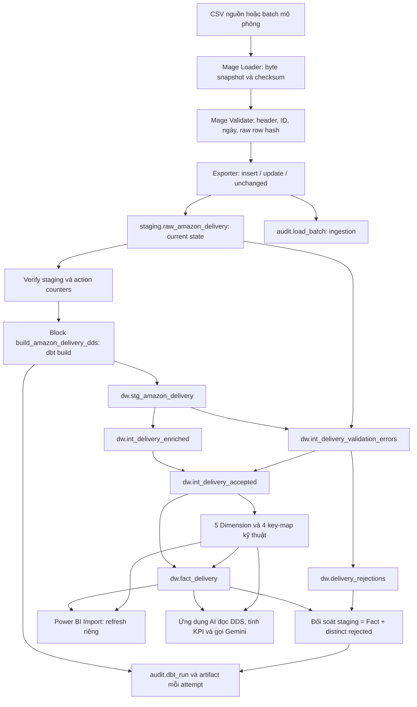

# Source-to-Target Mapping — triển khai hiện hành

Cập nhật 22/11/2026 từ code Mage, SQL/dbt và semantic model. Đây là mô tả triển khai hiện hành, không tự phê duyệt lại quy tắc nghiệp vụ ban đầu. Chi tiết mọi cột ở [Data Dictionary](DATA_DICTIONARY.md).

## 1. Nguồn, phạm vi và grain

- Nguồn: Amazon Delivery Dataset; [Kaggle](https://www.kaggle.com/datasets/sujalsuthar/amazon-delivery-dataset), file `data/raw/amazon_delivery.csv`, 43.739 dòng/16 cột trong snapshot nguồn. Không khẳng định dữ liệu vận hành chính thức Amazon.
- Thời gian nghiệp vụ: 11/02–06/04/2022, 44 ngày có nguồn; không phải lịch trigger hoặc watermark.
- Staging: một phiên bản hiện hành/Order_ID theo trim/case-fold của Mage; giữ 16 giá trị raw, upsert bằng hash 15 thuộc tính ngoài ID.
- Fact: một dòng/order_id được dbt hard-rule chấp nhận, 33 cột; không phải 43.739 dòng cố định hoặc số giao thành công.
- Delivery Time hiển thị phút là giả định của nhóm; 195 phút là baseline thống kê, không phải SLA.

## 2. Lineage tổng thể

Schema dbt phụ thuộc target; runner hiện tạo profile `schema: dw`. Database source dbt lấy từ `DBT_SQLSERVER_DATABASE`, runner đặt bằng `MSSQL_DATABASE`. Không gắn cứng `AmazonDeliveryBI` khi demo dùng `AmazonDeliveryBI_Demo`.

## 3. Mapping đủ 16 cột nguồn

Mage giữ nguyên các chuỗi dưới đây trong staging; các kiểu ở bảng là cast dbt, không phải kiểu raw. Required/range tham chiếu `dbt_project/dbt_project.yml`.

| CSV/raw | stg (cast/chuẩn hóa) | Đích semantic / dẫn xuất | Kiểm tra hiện tại |
|---|---|---|---|
| Order_ID | order_id VARCHAR, trim | Fact order_id, delivery_key | Mage loại null-like/quá 32; duplicate trong batch fail cả batch; giữa batch upsert trim/case-fold. dbt unique/not null |
| Agent_Age | agent_age SMALLINT | Fact tuổi, age_group, underage_agent_flag | Required, cast được, >=0; dưới 18 chỉ gắn cờ |
| Agent_Rating | agent_rating_raw DECIMAL(4,2) | Fact raw/valid rating, nhóm và cờ | Required, [1,5]; dòng thiếu/ngoài miền có ở staging/rejection, không vào Fact hiện hành |
| Store_Latitude | store_latitude DECIMAL(12,8) | Haversine, cờ/nhóm/status khoảng cách | Required, [-90,90]; không đưa tọa độ vào Fact |
| Store_Longitude | store_longitude DECIMAL(12,8) | Cùng quy tắc khoảng cách | Required, [-180,180] |
| Drop_Latitude | drop_latitude DECIMAL(12,8) | Cùng quy tắc khoảng cách | Required, [-90,90]; không gửi tọa độ chi tiết cho AI |
| Drop_Longitude | drop_longitude DECIMAL(12,8) | Cùng quy tắc khoảng cách | Required, [-180,180] |
| Order_Date | order_date DATE, style 23 | dim_date.full_date → Fact date_key | Mage reject ngày không parse; dbt required. Ngày hợp lệ ngoài lịch có thể lookup về key 0 |
| Order_Time | order_time TIME(0) | Fact order_time/order_hour/time_period, pickup delay | Required, cast hợp lệ; không thay thiếu bằng 00:00 |
| Pickup_Time | pickup_time TIME(0) | Fact pickup_time/rollover/delay | Required; pickup nhỏ hơn order được cộng 1 ngày |
| Weather | weather_name, trim/null | dim_delivery_condition → Fact delivery_condition_key | Optional, thiếu thành Unknown ở enriched |
| Traffic | traffic_level, trim/null | Cùng tổ hợp Weather–Traffic | Optional; tra bằng cả hai thuộc tính |
| Vehicle | vehicle_type, trim/null | dim_vehicle → Fact vehicle_key | Optional; thiếu Unknown; giữ bicycle |
| Area | area_name_raw và area_name | dim_area → Fact area_key | Optional; Metropolitian → Metropolitan; raw nguồn không bị đổi |
| Delivery_Time | delivery_time_minutes DECIMAL(10,2) | Fact duration, baseline/IQR flags | Required, không âm; không có max=270 trong rule; phút là giả định |
| Category | category_name, trim/null | dim_category → Fact category_key | Optional; thiếu Unknown; giữ Grocery |

Lỗi Mage ID/ngày được loại trước staging; hard rules dbt tạo error records cho dòng đã vào staging. Một dòng dbt có thể có nhiều error records.

## 4. Mapping trường dẫn xuất và khóa

| Nhóm | Đích / quy tắc hiện hành |
|---|---|
| delivery_key | CONVERT CHAR(64), HASHBYTES SHA2_256(order_id đã trim); không phải raw row hash hoặc checksum file |
| 5 FK Fact | date_key, delivery_condition_key, vehicle_key, area_key, category_key; COALESCE lookup thất bại về 0; dbt relationship tests kiểm tra tồn tại parent, không tự ghi riêng counter lookup thất bại |
| Calendar | Lịch cấu hình 2022 + Unknown 0; YYYYMMDD, ngày/tháng/quý/năm, thứ Monday=1, ISO week. DATEPART/UNION suy ra INT cho nhiều thuộc tính, không ép theo kiểu thiết kế cũ |
| Dimension phân loại | Lấy từ accepted, cộng Unknown. 4 bảng key-map có INT IDENTITY và unique natural keys duy trì khóa qua rebuild; không phải SCD2 |
| Pickup | Ghép ngày/giờ; pickup<order cộng 1 ngày; delay = chênh giây/60, DECIMAL(10,2); thiếu đầu vào thì NULL trước accepted |
| Rating/age/time groups | Từ delivery_rules; rating invalid/Unknown vẫn có thể thấy ở enriched nhưng hard-rule loại dòng không đạt khỏi accepted |
| Haversine | FLOAT, bán kính 6371 km, clamp a về [0,1]; store=(0,0) không tính. Giữ distance>50, valid_distance_flag=0, distance_outlier_flag=1, status/band giải thích |
| Baseline/IQR | above_baseline_p90_flag khi duration>195; IQR flag khi <-15 hoặc >265; cờ không tự loại outlier |
| delivery_count | TINYINT 1 mỗi dòng Fact |
| Missing context | Cờ thiếu order_time/weather/traffic theo cấu hình, không khẳng định thiếu toàn bộ ngữ cảnh |

Fact có đủ 33 cột được liệt kê theo kiểu/ý nghĩa trong Data Dictionary; hai cột bổ sung so với mô hình 31 cột ban đầu là `distance_outlier_flag`, `distance_status`.

## 5. Mapping lineage insert và update

| Trường staging | Nguồn / cách cập nhật | Truyền xuống Fact? |
|---|---|---|
| staging_row_id | IDENTITY insert đầu, không đổi khi update | Không; dùng đối soát/rejection |
| source_file_name/source_row_number | Tệp và record index (1-based, bỏ header) insert đầu | Chỉ source_file_name |
| load_batch_id/loaded_at | Batch và UTC insert đầu | Có cả hai; không phải batch/giờ dbt mới nhất |
| row_hash | SHA-256 JSON 15 raw attributes ngoài Order_ID | Không |
| updated_load_batch_id/updated_at | Insert khởi tạo; update đổi sang lần ghi gần nhất; unchanged không đổi | Không |
| updated_source_file_name/updated_source_row_number | Tệp/record của phiên bản hiện hành | Không |

Không dùng Fact.load_batch_id để đếm tất cả dòng được cập nhật bởi run mới. Staging current-state không chứa mọi phiên bản lịch sử; bộ đếm audit và snapshot attempt là nguồn giám sát.

## 6. Audit và consumer

- Ingestion: `audit.load_batch` gồm read/insert/update/unchanged/rejected/loaded. Thành công: read = insert + update + unchanged + rejected; loaded = insert + update.
- dbt: `audit.dbt_run` 1:n với load_batch, lưu trạng thái riêng và JSON test counts/row snapshot/reconciliation. Chưa có dbt row không đồng nghĩa thành công.
- DDS: staging = Fact + COUNT(DISTINCT rejection.staging_row_id). Không cộng error records vào Fact và không cộng rejection Mage với dbt mà bỏ qua phạm vi.
- Power BI: đọc Fact/5 Dimension Import, có Date Hierarchy; cần refresh. Không có trang ETL Monitoring trong 4 trang nghiệp vụ được kiểm tra tại thời điểm task này.
- AI: đọc cùng DDS nhưng tính KPI bằng Python, filter riêng; so cùng snapshot/filter và xử lý BLANK/NULL khi đối chiếu DAX. Chỉ aggregate/evidence đi vào Gemini, không có SQL tự sinh bằng LLM.

## 7. Chênh lệch với thiết kế ban đầu

Tài liệu thiết kế cũ muốn giữ missing Order_Time/rating và rating 6 trong Fact; code hiện yêu cầu các trường này và loại hard-rule violations. Task metadata chỉ ghi nhận khác biệt, không tự sửa rule. Số profiling nguồn chỉ dùng tham khảo; nghiệm thu KPI trên accepted Fact và cùng filter context. Xem [KPI Dictionary](KPI_DICTIONARY.md) và [handoff](../report/METADATA_AUDIT_HANDOFF.md).
