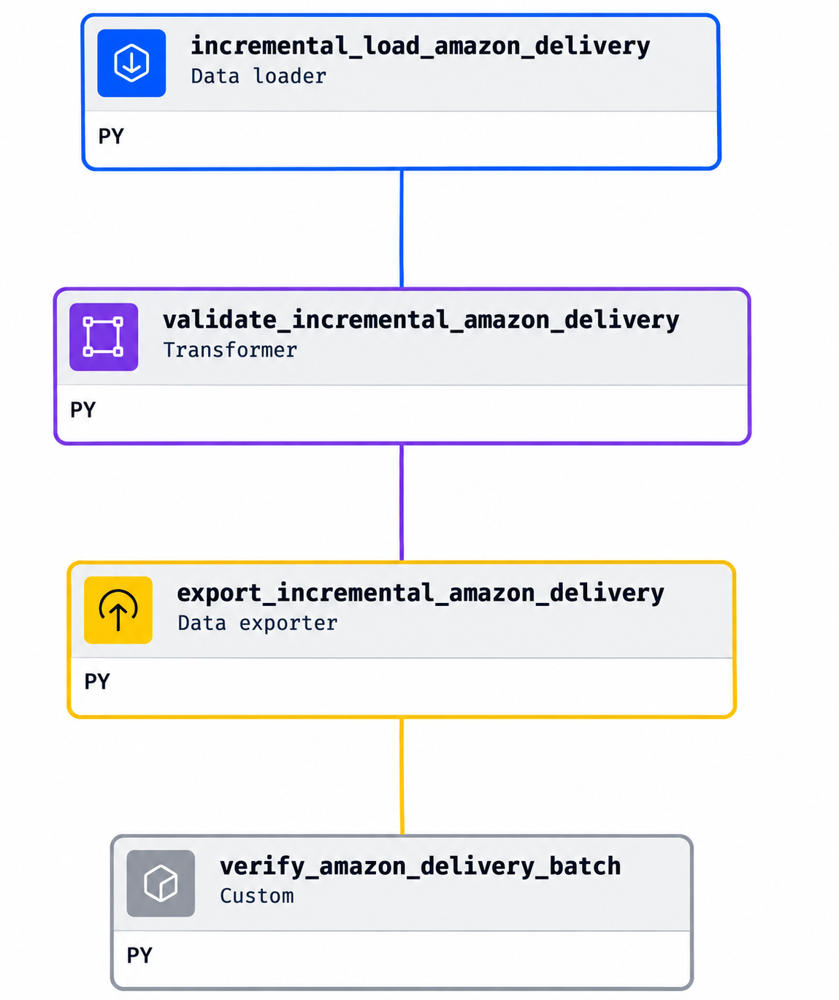

# LUỒNG DỮ LIỆU TỪ CSV ĐẾN `fact_delivery`

## 1. Mục đích tài liệu

Tài liệu trình bày toàn bộ quá trình dữ liệu đi từ tệp CSV nguồn đến bảng Fact trung tâm của Data Warehouse. Luồng được triển khai bằng bốn thành phần chính:

- **CSV**: chứa dữ liệu nguồn Amazon Delivery.
- **Mage.ai**: đọc file, kiểm tra, quản lý batch và nạp dữ liệu.
- **SQL Server**: lưu dữ liệu raw, audit và các bảng Data Warehouse.
- **dbt**: chuẩn hóa, áp dụng business rule, tạo Dimension, Fact và kiểm thử dữ liệu.

Luồng tổng quát:

```text
data/raw/amazon_delivery.csv
             |
             v
      Mage.ai Data Loader
             |
             v
   Transformer / Validation
             |
             v
      Data Exporter + Audit
             |
             v
staging.raw_amazon_delivery
             |
             v
    dbt: stg_amazon_delivery
             |
             v
 dbt: int_delivery_enriched
             |
             v
 int_delivery_validation_errors ------> delivery_rejections
             |
             v
    int_delivery_accepted
         /          \
        v            v
  5 Dimension   fact_delivery
        \            /
         v          v
           dbt Data Tests
```

---

## 2. Dữ liệu CSV nguồn

### 2.1. Vị trí file

```text
BI_AI_Project/data/raw/amazon_delivery.csv
```

### 2.2. Đặc điểm dữ liệu

- Số dòng: **43.739**.
- Số cột nguồn: **16**.
- Khoảng thời gian: **11/02/2022 đến 06/04/2022**.
- Số ngày có dữ liệu: **44 Active Days**.
- Khóa nghiệp vụ nguồn: `Order_ID`.

Mười sáu trường nguồn gồm:

```text
Order_ID
Agent_Age
Agent_Rating
Store_Latitude
Store_Longitude
Drop_Latitude
Drop_Longitude
Order_Date
Order_Time
Pickup_Time
Weather
Traffic
Vehicle
Area
Delivery_Time
Category
```

### 2.3. Grain nguồn

Một dòng CSV đại diện cho một bản ghi giao hàng nguồn được nhận diện bằng một `Order_ID`.

Không khẳng định mỗi dòng là một đơn đã giao thành công vì dataset không có trường delivery status.

---

## 3. Mage.ai đọc dữ liệu CSV



*Hình 1. Pipeline Incremental Load trong Mage.ai gồm Data Loader, Transformer, Data Exporter và Custom Verification.*

Mage.ai chịu trách nhiệm ingestion, tức là đưa dữ liệu từ file nguồn vào SQL Server. Mage không thực hiện các phép biến đổi nghiệp vụ chính và không tạo Dimension hoặc Fact.

Mỗi pipeline nạp dữ liệu gồm bốn block:

```text
Data Loader
    -> Transformer
    -> Data Exporter
    -> Custom Verification
```

### 3.1. Data Loader

Data Loader thực hiện các bước:

1. Đọc biến môi trường `BI_PROJECT_ROOT`.
2. Xác định đường dẫn đến `amazon_delivery.csv`.
3. Đọc toàn bộ file thành một snapshot byte duy nhất.
4. Tính checksum SHA-256 từ snapshot đó.
5. Parse CSV thành Pandas DataFrame.
6. Đọc tất cả trường dưới dạng chuỗi bằng `dtype=str`.
7. Không tự chuyển chuỗi rỗng hoặc `NaN` thành giá trị khác.
8. Trả về DataFrame, tên file và checksum.

Checksum có chức năng nhận diện nội dung file và hỗ trợ kiểm tra rerun. Checksum và DataFrame được tạo từ cùng một snapshot để tránh trường hợp file thay đổi giữa lúc tính checksum và lúc đọc dữ liệu.

### 3.2. Transformer/Validation

Với Full Load, Transformer kiểm tra:

- Đúng 43.739 dòng.
- Đúng 16 cột.
- Đúng tên cột.
- Đúng thứ tự header.

Với Incremental Load, Transformer kiểm tra thêm:

- `batch_name` thuộc danh sách được phép.
- `Order_Date` chuyển đổi được.
- Dữ liệu nằm đúng khoảng ngày của batch.
- Số dòng sau khi lọc đúng cấu hình.
- `Order_ID` không rỗng.
- `Order_ID` không trùng trong cùng batch sau khi trim và chuẩn hóa chữ hoa/chữ thường.

Nếu một điều kiện không đạt, pipeline dừng trước khi ghi dữ liệu vào staging.

### 3.3. Full Load và Incremental Load

Project hỗ trợ hai phương án nạp thay thế nhau.

#### Phương án 1: Full Load toàn bộ

```text
FULL_DATASET = 43.739 dòng
```

#### Phương án 2: Incremental mô phỏng

| Batch | Loại | Khoảng ngày | Số dòng |
|---|---|---:|---:|
| `INITIAL_FULL` | Full Load ban đầu | 11/02-18/02/2022 | 6.982 |
| `INCREMENTAL_01` | Incremental | 01/03-31/03/2022 | 30.658 |
| `INCREMENTAL_02` | Incremental | 01/04-06/04/2022 | 6.099 |
| **Tổng** | | | **43.739** |

Không chạy đồng thời Full Load toàn bộ và ba batch incremental trên cùng một staging vì các phương án chứa cùng `Order_ID`.

Incremental hiện tại là mô phỏng lịch sử bằng cách lọc cùng một CSV theo ngày. Đây chưa phải luồng nhận file hoặc event mới tự động theo thời gian thực.

---

## 4. Audit và Data Exporter

### 4.1. Bảng `audit.load_batch`

Mỗi lần pipeline chạy tạo một `load_batch_id` riêng. Bảng audit lưu:

- Tên và loại batch.
- Tên file nguồn.
- Checksum SHA-256.
- Khoảng ngày và số dòng dự kiến.
- Số dòng đã đọc, đã nạp và bị từ chối.
- Thời gian bắt đầu và kết thúc.
- Trạng thái.
- Thông báo lỗi.

Bốn trạng thái batch:

| Trạng thái | Ý nghĩa |
|---|---|
| `STARTED` | Pipeline đã bắt đầu chạy. |
| `SUCCEEDED` | Toàn bộ batch đã được nạp và đối soát thành công. |
| `FAILED` | Batch xảy ra lỗi; dữ liệu staging của batch được rollback. |
| `SKIPPED` | Batch tương đương đã thành công trước đó; không nạp thêm dữ liệu. |

### 4.2. Quy trình Data Exporter

Data Exporter thực hiện theo thứ tự:

1. Tạo `load_batch_id` mới.
2. Kiểm tra batch tương đương đã `SUCCEEDED` hay chưa.
3. Kiểm tra `Order_ID` có overlap với staging hiện tại không.
4. Ghi audit ở trạng thái `STARTED`.
5. Commit riêng trạng thái `STARTED` để giữ lịch sử lần chạy.
6. Insert toàn bộ dữ liệu batch vào `staging.raw_amazon_delivery`.
7. Đếm lại số dòng theo `load_batch_id`.
8. Nếu số dòng đúng, cập nhật `SUCCEEDED` và commit.
9. Nếu có lỗi, rollback phần dữ liệu staging.
10. Cập nhật audit thành `FAILED` và lưu thông báo lỗi.

Việc commit `STARTED` trước giúp hệ thống vẫn lưu được dấu vết của lần chạy thất bại.

### 4.3. Idempotency và rerun

Khi chạy lại một batch đã hoàn thành, hệ thống kiểm tra kết hợp:

- `batch_name`.
- `batch_type`.
- Checksum.
- Khoảng ngày.
- Số dòng dự kiến.
- `rows_read` và `rows_loaded`.
- Số dòng staging thực tế của batch thành công trước đó.

Nếu tất cả điều kiện khớp, lần chạy mới được ghi là `SKIPPED`, `rows_loaded = 0` và tổng số dòng staging không tăng.

Không thể chỉ dùng checksum vì ba batch incremental được lấy từ cùng một file CSV nên có cùng checksum.

### 4.4. Custom Verification

Sau khi exporter hoàn thành, block verification đọc lại SQL Server để kiểm tra:

- Audit batch vừa chạy có tồn tại.
- Trạng thái trong audit khớp kết quả exporter.
- Checksum khớp.
- `rows_read`, `rows_loaded` và `rows_rejected` khớp.
- Batch `SUCCEEDED` có đúng số dòng staging.
- Batch `SKIPPED` không ghi thêm dòng staging.

---

## 5. Bảng `staging.raw_amazon_delivery`

Đây là điểm giao giữa Mage.ai và dbt.

### 5.1. Chức năng

- Giữ nguyên dữ liệu nguồn.
- Không trim chuỗi.
- Không chuẩn hóa `NaN`.
- Không sửa lỗi chính tả `Metropolitian`.
- Không sửa dấu tọa độ.
- Không loại outlier.
- Cho phép truy ngược dữ liệu về file, dòng nguồn và batch.

Mười sáu cột nguồn được lưu dạng chuỗi để hạn chế mất dữ liệu và tránh ingestion thất bại do lỗi kiểu dữ liệu.

### 5.2. Lineage bổ sung

| Trường | Chức năng |
|---|---|
| `source_file_name` | Tên file CSV nguồn. |
| `source_row_number` | Vị trí ban đầu của dòng trong CSV. |
| `load_batch_id` | Batch Mage đã nạp dòng dữ liệu. |
| `loaded_at` | Thời điểm dữ liệu được nạp. |

### 5.3. Các lớp bảo vệ trong database

- Primary key trên `staging_row_id`.
- Foreign key từ `load_batch_id` đến `audit.load_batch`.
- Unique index trên `(load_batch_id, source_row_number)`.
- Unique filtered index trên `Order_ID` khác null.

Các constraint này là lớp bảo vệ cuối nếu validation ở Mage bị bỏ qua hoặc có lỗi.

---

## 6. dbt Source

dbt khai báo bảng raw là Source:

```text
source('staging', 'raw_amazon_delivery')
```

dbt không đọc CSV trực tiếp và không thay thế nhiệm vụ ingestion của Mage. Từ Source này, dbt xây dựng dependency graph:

```text
staging.raw_amazon_delivery
    -> stg_amazon_delivery
    -> int_delivery_enriched
    -> Dimensions
    -> fact_delivery
    -> data tests
```

---

## 7. Model `stg_amazon_delivery`

`stg_amazon_delivery` là lớp chuẩn hóa kỹ thuật đầu tiên của dbt và được materialize dưới dạng view.

### 7.1. Chuẩn hóa chuỗi

Mỗi giá trị được trim. Các giá trị sau được chuyển thành SQL `NULL`:

```text
Chuỗi rỗng
NaN
NULL
```

### 7.2. Chuyển kiểu dữ liệu

dbt sử dụng `TRY_CONVERT`:

| Trường | Kiểu đích |
|---|---|
| `Agent_Age` | `SMALLINT` |
| `Agent_Rating` | `DECIMAL` |
| Tọa độ | `DECIMAL` |
| `Order_Date` | `DATE` |
| `Order_Time`, `Pickup_Time` | `TIME` |
| `Delivery_Time` | `DECIMAL` |

`TRY_CONVERT` trả về null nếu giá trị không chuyển được thay vì làm toàn bộ model thất bại. Test `test_staging_cast_failures` đảm bảo lỗi chuyển kiểu không bị bỏ qua.

### 7.3. Chuẩn hóa Area

```text
Metropolitian -> Metropolitan
```

`area_name_raw` vẫn được giữ để truy vết giá trị gốc; `area_name` chứa giá trị đã chuẩn hóa.

### 7.4. Đầu ra

Đầu ra của model gồm:

- Các trường đã trim và chuyển kiểu.
- Các trường phân loại đã chuẩn hóa cơ bản.
- Toàn bộ metadata lineage.

Model này chưa tạo KPI tổng hợp và chưa loại các dòng bất thường.

---

## 8. Model `int_delivery_enriched`

Đây là lớp áp dụng business rule và tạo dữ liệu phân tích. Model được materialize dưới dạng view.

### 8.1. Tạo khóa kỹ thuật

`delivery_key` được tạo xác định từ `Order_ID`:

```text
delivery_key = SHA-256(Order_ID)
```

Cùng một `Order_ID` luôn tạo cùng một `delivery_key`.

### 8.2. Chuẩn hóa giá trị phân loại thiếu

Weather, Traffic, Vehicle, Area và Category thiếu được biểu diễn bằng `Unknown` và vẫn có thể vào Fact nếu các trường bắt buộc khác hợp lệ. `missing_operational_context_flag` ghi nhận Weather/Traffic thiếu; Vehicle, Area và Category thiếu tra vào Unknown Member của Dimension tương ứng.

### 8.3. Tạo khung giờ

| Khoảng giờ | `time_period` |
|---|---|
| 00:00-05:59 | `Night` |
| 06:00-11:59 | `Morning` |
| 12:00-17:59 | `Afternoon` |
| 18:00-23:59 | `Evening` |
| Thiếu giờ | `Unknown` trong intermediate; dòng bị loại trước Fact |

### 8.4. Tạo nhóm tuổi

| Điều kiện | `age_group` |
|---|---|
| Tuổi dưới 18 | `Under 18` |
| 18-24 | `18-24` |
| 25-34 | `25-34` |
| 35-44 | `35-44` |
| Từ 45 | `45+` |
| Thiếu tuổi | `Unknown` trong intermediate; dòng bị loại trước Fact |

Tuổi dưới 18 không bị xóa mà được gắn `underage_agent_flag = 1`.

### 8.5. Xử lý rating

- `agent_rating_raw` giữ giá trị sau chuyển kiểu.
- Rating từ 1 đến 5 được đưa vào `agent_rating_valid`.
- Rating ngoài 1-5 được ghi vào `delivery_rejections` và không vào DDS.
- `valid_rating_flag` cho biết rating có hợp lệ hay không.
- `rating_group` hỗ trợ phân nhóm phân tích.

Rating 6 vẫn ở raw để đối chiếu; bảng lỗi lưu `staging_row_id`, cột, giá trị nguồn và lý do loại.

### 8.6. Tính pickup delay

Hệ thống tạo:

```text
order_timestamp  = Order_Date + Order_Time
pickup_timestamp = Order_Date + Pickup_Time
```

Nếu `Pickup_Time < Order_Time`, pickup được xem là xảy ra vào ngày tiếp theo:

```text
pickup_timestamp = Order_Date + 1 ngày + Pickup_Time
```

Sau đó:

```text
pickup_delay_minutes = pickup_timestamp - order_timestamp
```

Ví dụ:

```text
Order Time  = 23:55
Pickup Time = 00:05
Pickup Delay = 10 phút
```

Trường hợp qua ngày được đánh dấu bằng `pickup_rollover_flag`.

### 8.7. Tính khoảng cách Haversine

Khoảng cách được tính từ bốn tọa độ Store và Drop bằng công thức Haversine với bán kính Trái Đất xấp xỉ 6.371 km.

Khoảng cách được tính và giữ nguyên khi có đủ bốn tọa độ nằm trong phạm vi vĩ độ [-90,90], kinh độ [-180,180] và tọa độ Store không phải `(0,0)`. `valid_distance_flag` là cờ phục vụ phân tích trong ngưỡng 50 km, không phải điều kiện nạp Fact.

Một khoảng cách được đánh dấu trong ngưỡng khi:

- Khoảng cách tính được không vượt 50 km.

Nếu đạt điều kiện:

```text
valid_distance_flag = 1
delivery_distance_km = khoảng cách Haversine
```

Nếu khoảng cách tính được vượt 50 km:

```text
valid_distance_flag = 0
distance_outlier_flag = 1
delivery_distance_km = khoảng cách Haversine thực tế
distance_status = Outlier >50 km
distance_band = >50 km
```

Nếu tọa độ Store là `(0,0)`, khoảng cách không đáng tin cậy để tính: `delivery_distance_km = NULL`, `distance_outlier_flag = 0`, `distance_status = 'Store coordinates (0,0)'` và `distance_band = 'Not calculable (Store 0,0)'`. Dòng vẫn ở Fact để đối chiếu tọa độ gốc; không tự tạo một số khoảng cách giả.

Đây là khoảng cách đường chim bay, không phải quãng đường thực tế trên mạng lưới giao thông.

### 8.8. Cờ chất lượng và nghiệp vụ

| Cờ | Ý nghĩa |
|---|---|
| `underage_agent_flag` | Tuổi nhỏ hơn 18. |
| `valid_rating_flag` | Rating nằm trong khoảng 1-5. |
| `above_baseline_p90_flag` | Delivery Time lớn hơn 195 phút. |
| `delivery_time_iqr_outlier_flag` | Delivery Time nằm ngoài biên IQR đã thiết lập. |
| `pickup_rollover_flag` | Pickup được giả định xảy ra vào ngày hôm sau. |
| `valid_distance_flag` | Khoảng cách đáp ứng quality rule. |
| `distance_outlier_flag` | Khoảng cách tính được lớn hơn 50 km. |
| `distance_status` | Trạng thái khoảng cách hoặc lý do không tính được. |
| `missing_operational_context_flag` | Thiếu Order Time, Weather hoặc Traffic. |

Ngưỡng 195 phút là P90 baseline thống kê, không phải SLA và không được gọi là ngưỡng giao trễ.

---

## 9. Tạo năm Dimension

Từ dữ liệu đã chuẩn hóa, dbt tạo năm Dimension.

### 9.1. `dim_date`

- Một dòng cho mỗi ngày lịch trong năm 2022.
- `date_key` có dạng `YYYYMMDD`.
- Cung cấp ngày, thứ, tuần, tháng, quý và năm.
- Có Unknown Member với key `0`.

### 9.2. `dim_delivery_condition`

- Một dòng cho mỗi tổ hợp Weather-Traffic.
- Là junk dimension gom hai thuộc tính có ít giá trị và thường được phân tích cùng nhau.

### 9.3. `dim_vehicle`

- Một dòng cho mỗi loại phương tiện.
- Hỗ trợ phân tích theo motorcycle, scooter, van, bicycle và các giá trị khác.

### 9.4. `dim_area`

- Một dòng cho mỗi khu vực đã chuẩn hóa.
- Sử dụng `area_name`, không sử dụng trực tiếp lỗi chính tả trong raw.

### 9.5. `dim_category`

- Một dòng cho mỗi danh mục hàng hóa.
- Hỗ trợ phân tích Delivery Time và khối lượng theo Category.

### 9.6. Surrogate key và Unknown Member

Dimension sử dụng surrogate key số nguyên. Weather/Traffic thiếu có thể tạo tổ hợp `Unknown` trong `dim_delivery_condition`; Vehicle, Area và Category thiếu tra vào Unknown Member key `0` của Dimension tương ứng. Key `0` cũng là phương án dự phòng nếu lookup không được; dữ liệu nguồn thiếu ở 11 cột bắt buộc đã bị loại trước khi tạo Fact.

Unknown Member giúp:

- Giữ lại dòng Fact.
- Không tạo foreign key null.
- Không phát sinh orphan relationship.
- Giữ quan hệ khóa ngoại khi có giá trị nguồn không khớp Dimension.

---

## 10. Tạo `fact_delivery`

### 10.1. Grain của Fact

> Một dòng trong `fact_delivery` đại diện cho một bản ghi giao hàng nguồn có `Order_ID` hợp lệ và duy nhất.

Với dữ liệu baseline:

```text
43.739 dòng raw -> 43.594 dòng fact_delivery + 145 dòng bị loại
```

`fact_delivery` là transaction fact vì mỗi dòng biểu diễn một sự kiện/bản ghi giao hàng ở mức chi tiết.

### 10.2. Điều kiện đầu vào

dbt chỉ đưa vào Fact các dòng không vi phạm quy tắc cứng và có đủ 11 cột nguồn bắt buộc. Weather, Traffic, Vehicle, Area và Category được phép thiếu, khi đó nhận `Unknown`; `Order_Time` thiếu vẫn bị loại. Lỗi chặn còn gồm chuyển kiểu thất bại ở trường bắt buộc, `order_id` trùng sau trim, tuổi âm, rating ngoài 1-5, tọa độ ngoài phạm vi và thời gian giao âm. Tuổi dưới 18, khoảng cách trên 50 km và ngoại lệ thống kê vẫn được giữ với cờ cảnh báo.

Model lấy dữ liệu chi tiết từ `int_delivery_accepted`, sau đó lookup năm Dimension để lấy:

- `date_key`.
- `delivery_condition_key`.
- `vehicle_key`.
- `area_key`.
- `category_key`.

Nếu lookup không thành công, khóa ngoại nhận giá trị `0`.

### 10.3. Ví dụ lookup Dimension

```text
int_delivery_enriched.area_name = Metropolitan
                    |
                    v
lookup dim_area.area_name
                    |
                    v
dim_area.area_key = 2
                    |
                    v
fact_delivery.area_key = 2
```

### 10.4. Các nhóm trường trong Fact

#### Khóa và quan hệ

- `delivery_key`.
- `order_id`.
- Năm foreign key đến Dimension.

#### Thời gian vận hành

- `order_time`.
- `pickup_time`.
- `order_hour`.
- `time_period`.
- `pickup_delay_minutes`.
- `pickup_rollover_flag`.

#### Thuộc tính agent

- `agent_age`.
- `age_group`.
- `underage_agent_flag`.
- `agent_rating_raw`.
- `agent_rating_valid`.
- `rating_group`.
- `valid_rating_flag`.

#### Measure giao hàng

- `delivery_time_minutes`.
- `delivery_distance_km`.
- `delivery_count` với giá trị 1 trên mỗi dòng.

#### Cờ chất lượng

- `above_baseline_p90_flag`.
- `delivery_time_iqr_outlier_flag`.
- `valid_distance_flag`.
- `distance_outlier_flag`.
- `distance_status`.
- `distance_band`.
- `missing_operational_context_flag`.

#### Lineage

- `source_file_name`.
- `load_batch_id`.
- `loaded_at`.

### 10.5. Vì sao không lưu KPI tổng hợp trong Fact?

Average, Median, P90, P95 và các tỷ lệ phụ thuộc vào filter context. Vì vậy chúng được tính lại trong Power BI thay vì lưu lặp trên từng dòng Fact.

`delivery_count` là additive và có thể `SUM`. Delivery Time, rating, pickup delay và distance là non-additive, nên thường dùng `AVERAGE`, `MEDIAN` hoặc percentile.

---

## 11. Kiểm thử sau khi tạo Fact

### 11.1. Test grain

`fact_delivery_grain` kiểm tra mỗi `Order_ID` chỉ xuất hiện một lần.

### 11.2. Test not-null và unique

Kiểm tra:

- `delivery_key` không null và không trùng.
- `order_id` không null và không trùng.
- Năm foreign key không null.
- Lineage bắt buộc không null.

### 11.3. Test relationships

Kiểm tra năm foreign key trong Fact đều tìm thấy khóa tương ứng trong Dimension.

### 11.4. Singular tests

| Test | Chức năng |
|---|---|
| `test_staging_cast_failures` | Kiểm tra mọi lỗi chuyển kiểu đều có trong bảng lỗi. |
| `test_agent_age_rules` | Kiểm tra nhóm tuổi và cờ dưới 18. |
| `test_delivery_time_nonnegative` | Delivery Time không được âm. |
| `test_approved_business_rules` | Kiểm tra các business rule đã duyệt. |
| `test_distance_validity_rules` | Kiểm tra khoảng cách, flag và distance band. |
| `test_rating_validity_rules` | Kiểm tra rating hợp lệ và các cờ tương ứng. |
| `test_delivery_rejection_reconciliation` | Đối soát raw = Fact + số dòng bị loại riêng biệt. |
| `test_rejected_orders_excluded` | Không để đơn bị loại xuất hiện trong Fact. |
| `test_required_analytics_fields` | Kiểm tra dòng được nhận không thiếu trường nguồn cần cho báo cáo. |

Kết quả runtime hiện có:

```text
7 table models
4 view models
78 data tests
PASS = 89
WARN = 0
ERROR = 0
SKIP = 0
```

---

## 12. Đối soát số dòng

Sau khi ETL hoàn thành, số dòng raw được chia thành Fact và bảng lỗi:

| Lớp | Số dòng |
|---|---:|
| `staging.raw_amazon_delivery` | 43.739 |
| `dw.stg_amazon_delivery` | 43.739 |
| `dw.int_delivery_enriched` | 43.739 |
| `dw.int_delivery_accepted` | 43.594 |
| `dw.fact_delivery` | 43.594 |
| Dòng raw bị loại riêng biệt | 145 |

Bảng `dw.delivery_rejections` có một dòng cho mỗi cột vi phạm: 54 rating thiếu, 91 giờ đặt thiếu và 53 rating ngoài 1-5. Cả 91 dòng thiếu Weather/Traffic hiện cũng thiếu giờ đặt nên vẫn bị loại. Khi đối soát phải đếm 145 `staging_row_id` riêng biệt để không đếm trùng dòng raw có nhiều lỗi.

Vehicle, Area và Category hiện được phép thiếu và sẽ nhận `Unknown` trong Fact, nhưng dữ liệu baseline không có dòng thiếu ba cột này; số dòng nêu trên vì vậy không thay đổi sau khi nới quy tắc.

---

## 13. Trách nhiệm của từng thành phần

| Thành phần | Trách nhiệm chính |
|---|---|
| CSV | Cung cấp dữ liệu nguồn. |
| Mage Data Loader | Đọc file và tính checksum. |
| Mage Transformer | Kiểm tra cấu trúc, batch, ngày và `Order_ID`. |
| Mage Exporter | Ghi audit, quản lý transaction và nạp raw staging. |
| Mage Verification | Đọc lại database để xác minh kết quả. |
| SQL Server | Lưu audit, raw staging, view và table Data Warehouse. |
| dbt Staging | Trim, chuẩn hóa null và chuyển kiểu. |
| dbt Intermediate | Áp dụng business rule, tính trường dẫn xuất, quality flag và phân loại lỗi cứng. |
| dbt Rejections | Lưu trạng thái hiện tại của các lỗi cứng cùng giá trị raw và lý do. |
| dbt Dimensions | Cung cấp các chiều phân tích và surrogate key. |
| dbt Fact | Lưu measure ở grain một `Order_ID`. |
| dbt Tests | Bảo vệ grain, khóa, quan hệ và business rule. |

---

## 14. Giá trị của thiết kế

Thiết kế này mang lại các lợi ích:

1. **Raw data bất biến**: dữ liệu nguồn không bị âm thầm sửa hoặc xóa.
2. **Lineage rõ ràng**: có thể truy từ Fact về batch, file và dữ liệu nguồn.
3. **Có khả năng chạy lại**: batch đã hoàn tất được `SKIPPED`, không nạp trùng.
4. **Có transaction**: lỗi giữa chừng không để lại dữ liệu staging nửa vời.
5. **Tách trách nhiệm**: Mage ingestion, dbt transformation, SQL Server storage.
6. **Chất lượng có thể kiểm chứng**: business rule được bảo vệ bằng data test.
7. **Phù hợp Power BI**: Star Schema hỗ trợ filter, aggregation và drill-down hiệu quả.

---

## 15. Hạn chế hiện tại

- Incremental Load đang mô phỏng từ cùng một CSV.
- Chưa có cơ chế tự động nhận file mới theo lịch.
- Chưa có watermark hoặc Change Data Capture từ hệ thống nguồn thật.
- Database đang chạy local, chưa phải production environment.
- Haversine chỉ là khoảng cách đường chim bay.
- `dim_date` hiện chỉ có lịch năm 2022; nếu nhận dữ liệu năm khác cần mở rộng lịch để lookup ngày, không coi năm khác là lỗi dữ liệu.
- Bảng lỗi được dựng lại mỗi lần dbt chạy, chưa lưu lịch sử các lần đánh giá/sửa lỗi.
- Dataset không có delivery status, SLA, promised time, doanh thu hoặc `Agent_ID`.
- Không thể kết luận quan hệ nhân quả từ các khác biệt mô tả.

---

## 16. Đoạn thuyết trình ngắn

> Dữ liệu bắt đầu từ file `amazon_delivery.csv` gồm 43.739 bản ghi và 16 cột. Mage.ai ghi dữ liệu nguyên trạng vào `staging.raw_amazon_delivery`. dbt chuẩn hóa, tính trường dẫn xuất và phân loại lỗi cứng hoặc giá trị thiếu ở trường báo cáo. Các dòng đạt điều kiện tạo năm Dimension và `fact_delivery`; dòng vi phạm được ghi vào `delivery_rejections` để đối chiếu với raw. Kết quả hiện tại: 43.739 dòng raw = 43.594 dòng Fact + 145 dòng bị loại; `dbt build` đạt 89/89 PASS.

---

## 17. Câu hỏi có thể được đặt ra

### Vì sao Mage không làm sạch dữ liệu luôn?

Mage phụ trách ingestion và giữ raw bất biến. dbt phụ trách transformation để business rule được quản lý tập trung, có lineage và có data test.

### Vì sao raw staging lưu các cột dưới dạng chuỗi?

Để bảo toàn giá trị nguồn và tránh làm ingestion thất bại do một giá trị sai kiểu. Việc chuyển kiểu được thực hiện có kiểm soát trong dbt.

### Vì sao cần `int_delivery_enriched`?

Lớp intermediate tập trung business rule dùng chung, tránh lặp logic trong từng Dimension và Fact.

### Vì sao Fact phải phụ thuộc vào Dimension?

Fact cần lookup các natural value để lấy surrogate key, từ đó tạo quan hệ Star Schema ổn định.

### Rating 6 và tuổi dưới 18 được xử lý ra sao?

Raw vẫn giữ cả hai giá trị để truy vết. Rating 6 là lỗi cứng nên dòng đó vào `delivery_rejections`, không vào DDS; tuổi dưới 18 được giữ trong DDS cùng `underage_agent_flag`.

### Vì sao không lưu P90 trong Fact?

P90 phụ thuộc vào tập dữ liệu đang được lọc. Power BI phải tính lại percentile theo filter context thay vì cộng hoặc lấy trung bình một giá trị lưu sẵn.

### Làm sao chứng minh không mất dữ liệu?

Raw/staging/intermediate có 43.739 dòng; Fact có 43.594 dòng và bảng lỗi có 145 `staging_row_id` riêng biệt. Test đối soát và các test unique, not-null, relationship, grain đều PASS.
